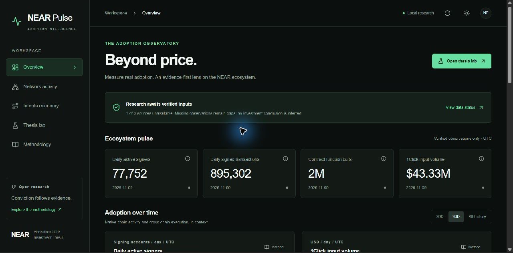

# NEAR Pulse

**Beyond Price. Measure Real Adoption.**

An independent Investment Thesis (`thesis`) entry for NEAR Hackathon 2026.
NEAR Pulse compares native-chain activity with successful cross-chain 1Click
swaps through a static research dashboard and reproducible Python analytics.
Deadline: November 14, 2026, 23:59 UTC.

**Verdict: Insufficient data.** Verified usage observations are available;
the price comparison is untested. Seven days provide six paired daily changes,
below the documented 30-pair minimum. No valuation or investment recommendation
is supported. Read [THESIS.md](THESIS.md).

## Published evidence

| Measurement                       | UTC coverage       | Notes                                              |
| --------------------------------- | ------------------ | -------------------------------------------------- |
| Signed transaction rows           | November 3-9, 2026 | Exact daily counts                                 |
| Distinct signing accounts         | November 3-9       | Accounts are not unique people                     |
| FUNCTION_CALL receipt-action rows | November 9 only    | 1,649,268; earlier days remain null                |
| Successful 1Click swaps           | November 3-9       | 134,156 unique swaps                               |
| 1Click input USD volume           | November 3-9       | $263,033,264.614200753422                          |
| NEAR/USD prices                   | Unpublished        | Private probe succeeded; public rights unconfirmed |

1Click is a subset of Intents activity. Swaps are grouped by creation UTC day;
success is observed at retrieval, not a completion-day measurement. Decimal CSV
sums are exact; chart JSON uses floating approximations. Both original November
9 datasets remain preserved in immutable archives. Coverage including calls is
one day; coverage including price is empty.

## Start locally

Requirements: Node 22.18+ and npm; Python 3.11+ for research replay/tests.

```powershell
Set-Location 'C:\Users\PC\Documents\Codex\near-pulse'
npm.cmd ci
npm.cmd run dev
```

Open **http://127.0.0.1:5173** (or Vite's reported fallback port). No wallet,
backend, database, private credentials or upstream calls are needed to view the
packaged dashboard. On other systems use `npm` instead of `npm.cmd`.

## Exact offline reproduction

From the project root, or after extracting the source archive:

```powershell
python -m pip install -r requirements.txt
python scripts/rebuild.py --mode replay --sources network,intents --start 2026-11-03 --end 2026-11-10
npm.cmd run build
```

Expected: seven network days and seven Explorer days, six null contract-call
dates, price unavailable, and Insufficient data verdict. Complete rebuild true
means the two requested sources replayed, not that thesis evidence is sufficient.
End bounds are exclusive UTC midnights. Replay uses reviewed raw exports and
makes no network requests. Raw sources are ignored by Git by default; the
reviewed source archive explicitly includes them and their original responses.
Do not omit them when preparing the eventual public repository.

`python scripts/rebuild.py` defaults to strict replay of all three sources using
environment bounds; it exits 2 while prices are unavailable. Use the explicit
command above for this release. `--allow-partial` permits missing sources but
does not establish statistical completeness. Do not run a source-only live
rebuild against production when intending to preserve the combined dashboard.

Outputs: `public/data/dashboard.json`, daily CSVs, `data/processed/evidence.json`
and SHA-256 output manifests. Unavailable price CSV has only a header. Raw input
hashes, original API response hashes and query jobs are retained in provenance.
See [historical audit](validation-evidence/historical-audit.json),
[methodology](docs/methodology.md), [source onboarding](docs/data-sources.md),
[incremental extraction](docs/history-acquisition.md), and
[private price probe/licensing](docs/price-configuration.md).

Source SQL: [transactions and signers](sql/verified_transactions.sql),
[function calls](sql/verified_function_calls.sql),
[receipt coverage](sql/verified_receipt_coverage.sql). Source:
`bigquery-public-data.crypto_near_mainnet_us`, location `us-east1`.
Every data query requires block_date predicates, dry-run estimates and hard
100,000,000-byte/query and 1,000,000,000-byte/run caps. Unknown/oversized estimates
are rejected. Paid acquisition requires separate explicit opt-in; replay is free.
Explorer acquisition uses bounded pagination, stable address-plus-memo identity,
one request per five seconds and complete-period validation. Do not repeat
acquisition merely to reproduce the release.

## Five research pages

- Overview: dated activity metrics, historical charts and source freshness.
- Network Activity: exact counts, time/transform controls, CSV and source SQL.
- Intents Economy: 1Click-only counts, exact USD totals and origin-asset shares.
- Thesis Lab: indexed adoption comparisons, lagged Spearman sample reporting,
  falsification rules and an evidence-dependent verdict.
- Methodology: source scope, provenance, calculation rules and reproduction.

Chart panels link to methodology and expose accessible tables. Missing data
stays missing. A private authenticated CoinGecko probe returned 168 samples for
November 3-9 with no missing days, as reported by the user; no prices were saved.
Authentication does not establish display or redistribution rights. Neither raw
prices nor price-derived observations are published in this release.

## Screenshots

Actual local desktop capture, November 13, 2026; browser chrome excluded:



Additional captures and verification limitations are listed in
[submission readiness](docs/submission-readiness.md). Screenshots illustrate
historical observations, not live data.

## Architecture and attribution

React, TypeScript, Vite, Tailwind CSS, Recharts, Lucide React and React Router;
Python pandas, scipy, requests, python-dotenv, and optional official BigQuery
client. Lockfile and requirements record dependencies. Codex assisted the code
and documentation. No external app template or Sentinel code was copied.

`src/` holds the five pages and shared UI; `scripts/providers/` contains ingestion;
`scripts/analysis/` computes metrics and research; `scripts/history.py` merges
without silently revising verified records; `sql/` contains validated queries;
`data/raw/` holds reviewed sources; `public/data/` serves static exports.
Synthetic fixtures exist only in automated tests. Secrets remain in local .env
or ADC, never Vite variables. MIT covers project code; source data remains
subject to its provider terms and recorded permissions.

## Checks and release archives

```powershell
python -m pytest -q
python -m compileall -q scripts tests
npm.cmd test
npm.cmd run typecheck
npm.cmd run build
python scripts/package_submission.py
```

Archives: `artifacts/near-pulse-source.zip` (replay inputs included),
`artifacts/near-pulse-static.zip` (dist contents), and SHA-256
`artifacts/manifest.json`. The packager excludes credentials and scans for local
secret values. See [VALIDATION.md](VALIDATION.md) for observed checks.

For Vercel-compatible hosting: Vite preset, install `npm ci`, build `npm run
build`, output `dist`; `vercel.json` provides SPA rewrites. No deployment was
performed. A static build can be reviewed locally using
`npm.cmd exec vite preview -- --host 127.0.0.1 --port 4173`.

## Submission handoff

See [60-90-second demo script](docs/demo-script.md) and
[readiness/blockers](docs/submission-readiness.md). The official instructions at
https://nearhackathon.com/HACKATHON.md were checked November 13, 2026.
A public repository and human-published X demo post are still required. For a
local-only demo, supply a video; screenshots alone do not suffice. The post must
state it was built at NEAR HACKATHON and include @NEARProtocol and #NEARHackathon.
The human must provide entry details, consent and confirm the exact payload
before submission. No publication, deployment, push or submission was performed.

Public replay-input delivery must be finalized before repository publication:
`data/raw/intents.json` is 241,138,717 bytes. Use reviewed Git LFS delivery or
provide the source archive as a public release asset with its actual URL and
checksum. The local archive already supports offline replay; do not silently
publish a repository that omits these inputs. See the readiness report.
